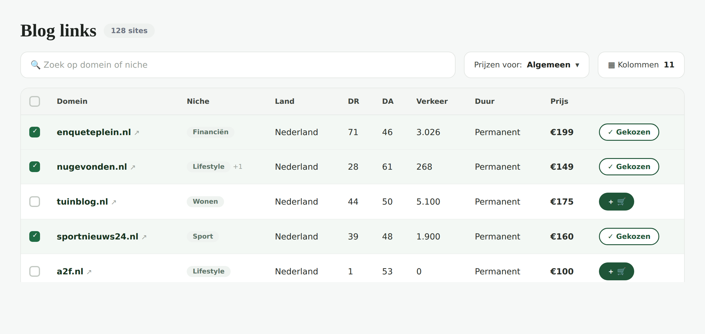
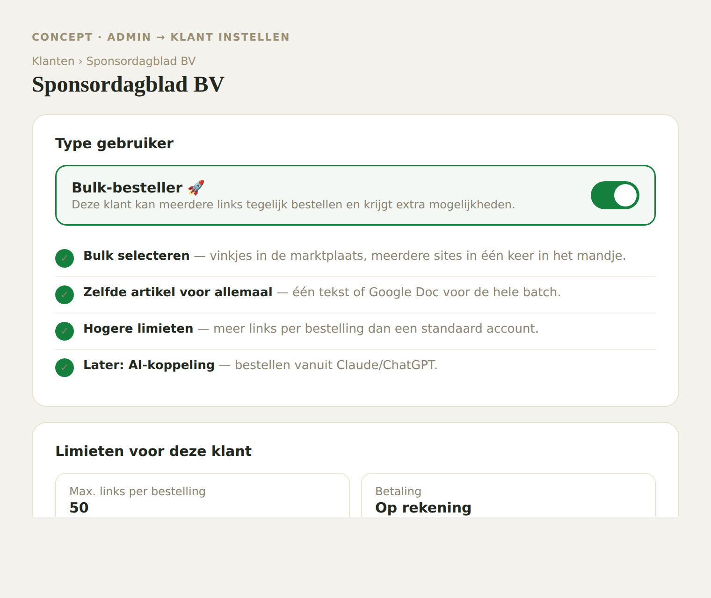
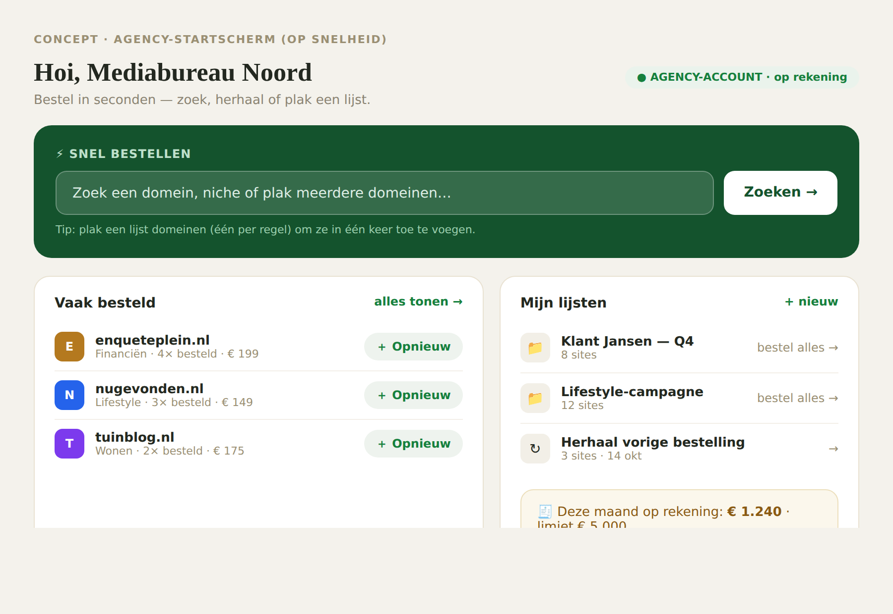
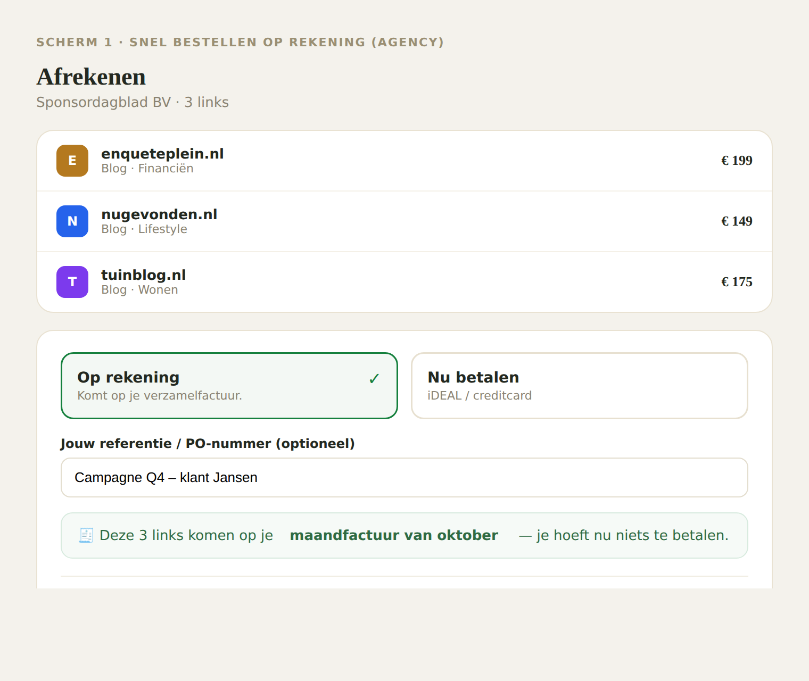
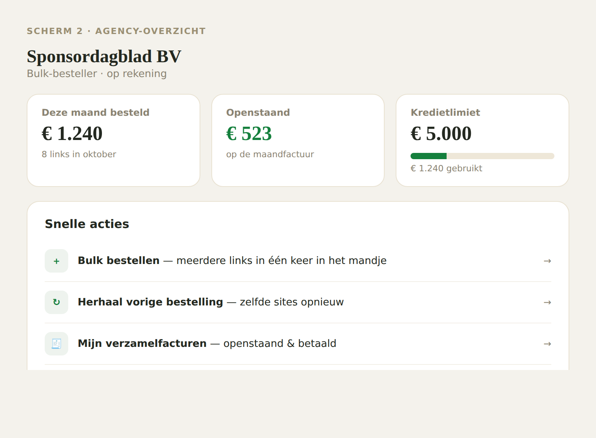
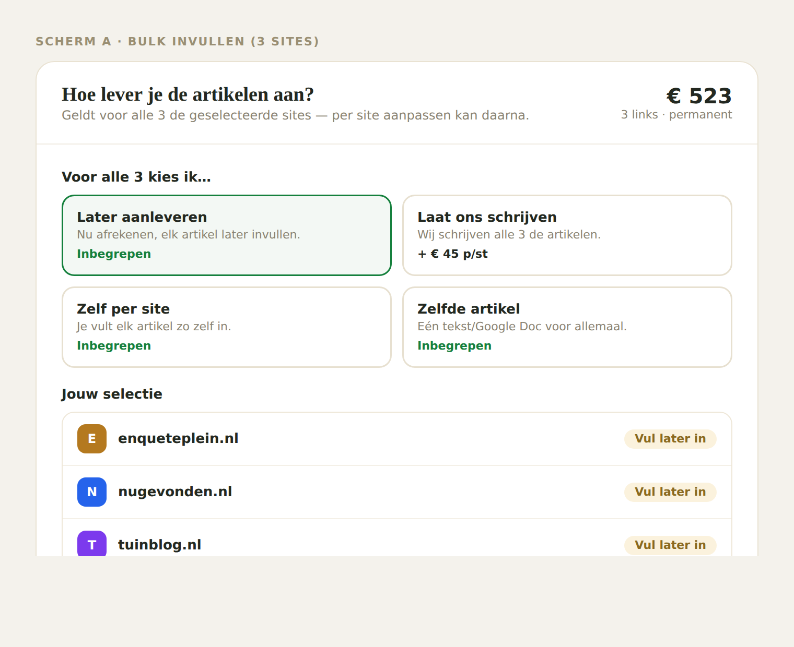

# Agency-module (toekomst)

Een samenhangend pakket waarmee **agencies / resellers** veel sneller kunnen
bestellen dan een gewone klant. Een agency plaatst vaak veel links achter
elkaar, voor meerdere eigen klanten — die moeten dat in seconden kunnen doen,
niet één voor één.

> Status: **concept / toekomstmuziek**. Nog niks gebouwd. Dit document legt de
> richting en de schermen vast zodat het bewaard blijft.

## Kernidee

1. Per klant een schakelaar **"Bulk-besteller"** in de admin. Staat die uit, dan
   ziet de klant gewoon de normale, rustige schermen. Staat die aan, dan krijgt
   díe klant extra mogelijkheden (bulk bestellen, op rekening, snelbestel-start).
2. De agency bestelt **direct uit het aanbod**: aanvinken wat ze willen, in één
   keer in het mandje. Geen domeinen plakken/matchen — gewoon kiezen uit wat er
   is. (Alleen tonen wat we hebben.)
3. Afrekenen gaat **op rekening** → komt op de bestaande **verzamelfactuur**.

## Belangrijke stijlregel

Het mag **niet afwijken van de huidige huisstijl**. Het is de bestaande
marktplaats + een paar extra's (vinkje-kolom, bestelbalk in zandkleur, zelfde
groene knoppen en lichtgroene niche-labels). Een gewone klant (zonder de
bulk-schakelaar) ziet alles precies zoals nu, zónder vinkjes.

## De schermen

### 1. Het aanbod als snel-bestelscherm
De marktplaats zoals nu, met een vinkje-kolom en een zand-bestelbalk onderin.
Aangevinkte rijen krijgen een zacht groen tintje. Onderin: "3 sites
geselecteerd · samen € 508 · op rekening" → "toevoegen aan mandje".

### 2. Bulk-besteller-schakelaar (admin → klant)
Op de klantpagina een schakelaar die de bulk-mogelijkheden aan/uit zet, met
een lijstje van wat het ontgrendelt en de limieten voor die klant.

### 3. Agency-startscherm (op snelheid)
Wat de agency als eerste ziet: een snelbestel-ingang, "vaak besteld" met
één-klik opnieuw, opgeslagen lijsten, en de maandstand op rekening.

### 4. Op rekening afrekenen
Bij afrekenen kiezen voor "Op rekening" i.p.v. direct betalen, met een
referentie/PO-nummer. Komt op de maandfactuur — nu niets betalen.

### 5. Agency-overzicht
Deze maand besteld / openstaand / kredietlimiet, plus snelle acties
(bulk bestellen, herhaal vorige bestelling, verzamelfacturen, teamleden).

### 6. Bulk invullen
Na het aanvinken in één keer kiezen hoe je alle artikelen aanlevert
(later aanleveren / laat ons schrijven / zelf per site / zelfde artikel).

## Voorgestelde bouwvolgorde (gefaseerd)

1. **Bulk-besteller-schakelaar** — één eigenschap op het klant-account
   (`bulkOrdering` aan/uit). Alle bulk-knoppen checken dit. Bouw dit één keer
   goed, dan kun je er later alles aan hangen.
2. **Aanbod met vinkjes + bestelbalk** — de marktplaats die ook bulk kan.
   Simpelste variant: alle geselecteerde items als "Later aanleveren" in het
   mandje, per stuk invullen. Hergebruikt het bestaande mandje.
3. **Op rekening afrekenen vanuit de webshop** (met PO-nummer) → sluit aan op de
   bestaande verzamelfactuur-logica.
4. **Bulk invullen** ("zelfde artikel voor allemaal") — de enige echt nieuwe
   logica; apart bouwen.
5. **Snelbestel-startscherm** (vaak besteld / herhaal / lijsten).
6. **Later/optioneel:** kredietlimiet (eerst alleen tonen, nog niet blokkeren),
   teamleden onder één account, AI-koppeling (zie `ai-koppeling.md`).

## Open beslissingen / aandachtspunten

- **Alleen tonen wat we hebben.** Geen "domeinen plakken en matchen", geen
  "aanvragen"-knop voor niet-gevonden domeinen. Strak houden.
- **Kredietlimiet:** begin met alleen tonen; bepaal later wat er gebeurt bij
  overschrijden (waarschuwen i.p.v. hard blokkeren).
- **Teamleden onder één bedrijf** (meerdere logins → één account) is een groter
  stuk; echt iets voor later.
- **Mobiel:** bestelbalk en bulk-invulscherm netjes stapelen op telefoon.
